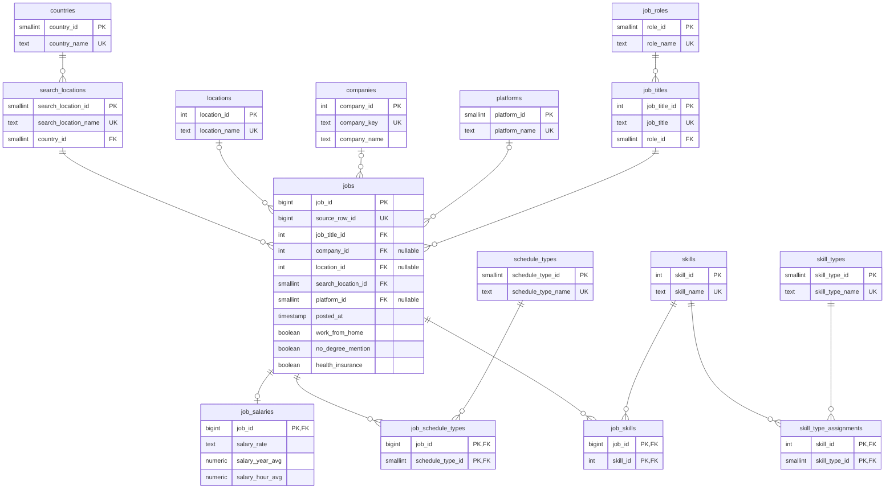

# Pipeline de ofertas de empleo: de CSV a un modelo 3FN en PostgreSQL

Este repositorio es mi solución a la prueba técnica de Data Engineer. El punto de partida es `data_jobs.csv`, con 785.741 ofertas de empleo de 2023 scrapeadas de Google Jobs. El objetivo es convertirlo en un modelo relacional normalizado (tercera forma normal) en PostgreSQL que sirva como fuente única de verdad para análisis posteriores.

Lo que construí:

- Un pipeline en Python y SQL con tres capas (`raw`, `staging`, `core`) que procesa el archivo completo en unos 4 minutos.
- Un modelo de 15 tablas, definido en [`sql/schema.sql`](sql/schema.sql), con su diagrama más abajo y en [`docs/erd.dbml`](docs/erd.dbml) para abrirlo en dbdiagram.io.
- Validación con Pandera antes de cada carga, chequeos de calidad después, 97 tests con pytest y CI en GitHub Actions.
- Todo corre en Docker Compose, y las dependencias se manejan con uv.
- Como bonus, una versión orquestada con Prefect y el diseño de un modelo estrella para BI.

El README sigue el orden en que trabajé: primero qué encontré en los datos, después cómo armé el pipeline y el modelo, cómo verifico que el resultado es correcto y, al final, cómo ejecutarlo. Para correrlo de una vez, las instrucciones están en [Cómo ejecutarlo](#cómo-ejecutarlo).

## Contenido

1. [Cómo lo abordé](#cómo-lo-abordé)
2. [Lo que encontré en los datos](#lo-que-encontré-en-los-datos)
3. [Arquitectura del pipeline](#arquitectura-del-pipeline)
4. [El modelo 3FN](#el-modelo-3fn)
5. [Calidad de datos](#calidad-de-datos)
6. [Tests](#tests)
7. [Resultado de una corrida](#resultado-de-una-corrida)
8. [Rendimiento: de 10 a 4 minutos](#rendimiento-de-10-a-4-minutos)
9. [Herramientas y por qué](#herramientas-y-por-qué)
10. [Bonus: orquestación y CI/CD](#bonus-orquestación-y-cicd)
11. [Bonus: un modelo estrella para BI](#bonus-un-modelo-estrella-para-bi)
12. [Lo que no hice y qué haría con más tiempo](#lo-que-no-hice-y-qué-haría-con-más-tiempo)
13. [Cómo ejecutarlo](#cómo-ejecutarlo)
14. [Estructura del repositorio](#estructura-del-repositorio)

---

## Cómo lo abordé

No empecé por el modelo. Lo primero fue leer el archivo completo con pandas y perfilar cada columna: nulos, valores distintos, los valores más frecuentes y, sobre todo, cosas que no cuadraran. Esa primera pasada cambió bastante lo que tenía en mente. Por ejemplo, yo daba por hecho que el país se podía colgar de la ubicación de la oferta, y los datos dicen que no.

Con el perfilado en la mano tomé tres decisiones antes de escribir código:

1. Guardar primero el CSV tal cual, solo con tipos correctos, para poder reprocesar sin volver al archivo.
2. Hacer la limpieza en Python, donde la puedo probar con tests unitarios.
3. Hacer la normalización final en SQL, que es donde los joins y las cargas por conjuntos son naturales.

En el camino hubo dos correcciones importantes, porque no salieron bien a la primera: una sobre los títulos de las ofertas y otra de rendimiento. Las cuento en sus secciones.

## Lo que encontré en los datos

Este es el resumen del perfilado. Cada fila de la tabla terminó siendo una regla de limpieza, una decisión del modelo o una limitación documentada.

| Hallazgo | Cuántos | Qué hice |
|---|---|---|
| Filas idénticas en las 17 columnas, fecha incluida al segundo | 101 | Las rechazo como duplicado y conservo la primera |
| Filas iguales salvo `job_posted_date` | unas 36 mil | Las dejo: son republicaciones de la misma oferta en otra fecha, no duplicados |
| Una fila sin título, empresa, ubicación ni skills | 1 | Rechazada |
| `job_schedule_type` con varios valores: "Full-time, Part-time, and Internship" | 48 combinaciones de 7 tipos | La separo en una relación N:M |
| Jornadas en indonesio: "Pekerjaan tetap", "Kontraktor" | 62 | Las traduzco a Full-time y Contractor (son las etiquetas de Google Jobs en ese idioma) |
| `job_via` con el prefijo "via " (y "melalui " en Indonesia) | todas | Quito el prefijo |
| La misma empresa escrita distinto: "BNP Paribas", "Bnp Paribas", "BNP PARIBAS" | 8.922 grupos | Las unifico: 139.985 nombres pasan a 130.368 empresas |
| Ubicaciones con "(+3 others)" al final | 2.642 | Quito el sufijo y conservo la ubicación principal |
| El mismo skill dos veces en una oferta (`['sas', ..., 'sas']`) | 63.811 ofertas | Deduplico. Pasa con sas, mongodb, ruby y firebase, que el extractor mete en dos categorías a la vez |
| Ofertas de Texas y Nuevo México con país "Sudan" | 21.781 | Documentado, no corregido (lo explico en el modelo) |
| La búsqueda "Georgia" (el país) devolvió ofertas de Georgia, EE. UU. | 32.424 | Mismo caso |
| `job_country` vacío | 49 | Todas vienen de búsquedas a nivel país ("Gabon", "Sierra Leone"), así que tomo ese país |
| Tarifa de salario mensual, semanal o diaria | 401 | El CSV solo trae promedio anual y horario, así que guardo la tarifa sin monto |
| Salarios con ruido de punto flotante (61.159996) | — | Redondeo a centavos en `core`; `raw` guarda el original |
| Títulos cortados por el scraper ("Senior Clinical Data Engineer / Principal...") | 15.790 | No hay cómo recuperarlos; quedan así |
| `job_work_from_home = True` exactamente cuando la ubicación es "Anywhere" | 69.552 | Lo dejo como atributo de la oferta (lo explico en el modelo) |

Otras cosas que vi y no toqué: entre las "empresas" hay agregadores de empleo (Emprego, Dice) y nombres genéricos como "Confidenziale" para ofertas anónimas. Separarlos requiere criterio de negocio, así que quedó anotado en lo que haría con más tiempo.

Con este panorama armé el pipeline.

## Arquitectura del pipeline

```
data_jobs.csv
     │  extract.py      lee, tipa, valida con Pandera y carga con COPY
     ▼
raw.job_postings         el CSV tal cual, con tipos reales (TEXT[], JSONB, BOOLEAN, TIMESTAMP)
     │  stage.py        limpia, estandariza, deduplica, separa rechazos, valida
     ▼
staging.job_postings     una fila por oferta, limpia pero todavía desnormalizada
staging.rejected_postings   lo que no pasó, con el motivo
     │  load_core.sql   carga por conjuntos en una transacción + chequeos de calidad
     ▼
core.*                   modelo 3FN (15 tablas)
```

Cada capa tiene un trabajo distinto:

- **raw** no limpia nada. Deja el dato con tipos correctos (las listas de skills como `TEXT[]` y el diccionario de tipos como `JSONB`) y con un `source_row_id`, el número de fila del CSV, que viaja hasta `core.jobs`. Si alguien duda de un valor del modelo, ese id lleva a la fila original. Y si cambia una regla de limpieza, se reprocesa desde aquí sin volver a leer el archivo.
- **staging** es donde vive la limpieza, escrita en Python. La tabla es `UNLOGGED`: se recrea en cada corrida, así que no tiene sentido pagar el costo del WAL (el log que Postgres usa para recuperarse de un crash). Si se pierde, basta con volver a correr el paso. Las filas que no pasan van a `staging.rejected_postings` con su motivo, para que nada se descarte en silencio.
- **core** se llena solo con SQL: `INSERT ... SELECT` resolviendo cada clave por el nombre natural del catálogo.

Todos los pasos son idempotentes: `raw` y `core` se recargan completos (`TRUNCATE` + carga) dentro de una transacción. Correrlo dos veces da el mismo resultado, y si algo falla a la mitad la base queda como estaba. Elegí recarga completa y no incremental por dos razones: la fuente es un archivo estático, y el CSV no trae un id de oferta, así que no hay una clave estable contra la cual hacer un upsert.

La capa `core` es el modelo 3FN, que es la parte central de la prueba.

## El modelo 3FN



En las líneas, `||` significa "exactamente uno", `|o` "cero o uno" y `o{` "cero o muchos". Por ejemplo, `companies |o--o{ jobs` se lee así: una oferta tiene como máximo una empresa (la FK admite nulos) y una empresa tiene muchas ofertas.

### Qué guarda cada tabla

| Tabla | Qué es | De dónde sale |
|---|---|---|
| `jobs` | Una fila por oferta publicada, con sus tres flags | Cada fila válida del CSV |
| `job_titles` | Cada título distinto y el rol que le corresponde | `job_title` + `job_title_short` |
| `job_roles` | Los 10 roles estandarizados (Data Engineer, Data Analyst...) | `job_title_short` |
| `companies` | Empresas unificadas por nombre normalizado | `company_name` |
| `locations` | Texto de ubicación de la oferta ("Bogotá, Colombia", "Anywhere") | `job_location` |
| `search_locations` | La búsqueda que hizo el bot y el país que le asignó | `search_location` + `job_country` |
| `countries` | Países | `job_country` |
| `platforms` | Dónde se publicó (LinkedIn, Indeed...) | `job_via` |
| `job_salaries` | Tarifa y promedios, solo para ofertas con salario | `salary_*` |
| `schedule_types` + `job_schedule_types` | Tipos de jornada y la relación N:M con las ofertas | `job_schedule_type` |
| `skills` + `job_skills` | Skills y la relación N:M con las ofertas | `job_skills` |
| `skill_types` + `skill_type_assignments` | Categorías de skill y la relación N:M con los skills | `job_type_skills` |

### Decisiones

Para cada columna me hice la misma pregunta: ¿de qué depende realmente este dato? En 3FN cada atributo tiene que depender de la clave de su tabla y de nada más. Lo importante es que la respuesta no la saqué solo del diccionario de datos: medí cada dependencia en las 785 mil filas, y el pipeline las vuelve a verificar en cada corrida.

#### El rol depende del título, no de la oferta

Según el diccionario, `job_title_short` se calcula a partir de `job_title`, y en los datos se cumple siempre: cada uno de los 234.674 títulos distintos tiene un solo rol. Si dejaba `role_id` en `jobs`, el rol dependería de la oferta a través del título (`job → job_title → rol`). Esa es una dependencia transitiva, justo lo que 3FN no permite. En la práctica, el título "Data Engineer" aparece en casi 54 mil ofertas: su rol se repetiría en cada una y nada impediría que alguna dijera otra cosa. Por eso existe `job_titles` con su `role_id`, y `jobs` solo apunta al título.

Aquí me equivoqué al principio. Mi primera versión limpiaba los espacios de los títulos (dobles espacios, espacios al final), y el chequeo de dependencias del pipeline falló: 26 títulos quedaron con dos roles distintos. Cuando miré los casos lo entendí. "MIS Analyst" aparece 60 veces como *Data Scientist*, y "MIS  Analyst", con doble espacio, como *Software Engineer*. El rol se calculó sobre el texto exacto, así que si "limpio" el título rompo la relación que el propio origen definió. Terminé guardando el título tal cual viene. Sin el chequeo automático esto habría pasado de largo.

#### El país depende de la búsqueda, no de la ubicación

Lo natural habría sido poner `country_id` en `locations`. No lo hice porque los datos no lo permiten: `job_location → país` falla en 1.166 ubicaciones. "Abilene, TX", por ejemplo, aparece con país United States y también con Sudan. En cambio, `search_location → país` se cumple en el 100% de las filas. O sea, el bot asigna el país según la búsqueda que hizo, no según dónde queda la oferta. El diccionario dice "Country extracted from the location", pero el dato real dice otra cosa, así que modelé lo que pasa de verdad: el país cuelga de `search_locations`.

Eso deja a la vista un problema del origen: la búsqueda "Sudan" trajo 21.781 ofertas que en su mayoría son de Estados Unidos. Lo pensé bastante y decidí no corregirlo. Hacerlo bien implica geocodificar `job_location`, que es otro proyecto, y una corrección a medias dentro de la fuente de verdad es peor que un error conocido y documentado. Además, con este diseño el error queda en un solo lugar (una fila de `search_locations`) en vez de repartido en miles de ofertas.

#### `work_from_home` se queda en `jobs`

En este dataset `work_from_home` es verdadero exactamente cuando la ubicación es "Anywhere", así que se podría argumentar que depende de la ubicación. No lo modelé así. Una dependencia funcional es una regla del negocio, no algo que coincide en una muestra: una oferta en Bogotá puede ser remota sin problema. La coincidencia viene de cómo el scraper etiqueta las ofertas remotas, y si mañana cambia eso no quiero que el modelo deje de ser correcto. Con el título sí acepté la dependencia, porque la respaldan dos cosas a la vez: el diccionario la define y los datos la confirman.

#### Skills: dos relaciones N:M, no una

La relación muchos a muchos entre ofertas y skills se resuelve con `job_skills`, de PK compuesta `(job_id, skill_id)`.

Lo que no esperaba fue el tipo de skill. Mi idea era una columna `skill_type_id` en `skills`, pero sas, mongodb, ruby y firebase pertenecen a dos tipos (sas es `programming` y también `analyst_tools`), y eso pasa en todas sus apariciones, no solo en algunas ofertas. Es decir, la clasificación es una propiedad del skill, no de la oferta. Por eso hay una segunda N:M, `skill_type_assignments`, entre skills y tipos. De paso, eso explica por qué esos skills aparecían repetidos en las listas del CSV.

La consecuencia es que `job_type_skills` no se guarda en `core`: se puede reconstruir uniendo `job_skills` con `skill_type_assignments`. No quise dejar esto como suposición, así que uno de los chequeos de calidad reconstruye el diccionario para las 785 mil ofertas y lo compara contra el original. Da cero diferencias.

#### La jornada rompía 1FN

"Full-time and Part-time" son dos valores en una sola celda, lo que viola la primera forma normal. Lo separé en `schedule_types` (7 tipos) y la tabla puente `job_schedule_types`. El 1,6% de las ofertas no trae jornada; esas simplemente no tienen filas en la puente, en vez de guardar un "desconocido" inventado.

#### El salario va en su propia tabla

Solo el 4,2% de las ofertas publica salario. Ponerlo en `jobs` eran tres columnas vacías en el 96% de las filas, así que va en `job_salaries`, con relación de cero o uno con `jobs`. Los `CHECK` de la tabla dejan escrita la regla del origen: el promedio anual solo existe con tarifa anual, y el horario solo con tarifa horaria.

No convertí el salario horario a anual (multiplicando por 2.080 horas, por ejemplo). Esa es una suposición de análisis, y me parece que corresponde a la capa de consumo, no a la fuente de verdad. La tarifa (`salary_rate`) la dejé como un `CHECK` con cinco valores y no como tabla catálogo: son valores fijos, sin atributos propios, y una tabla solo agregaba un join.

#### Claves sustitutas, con la natural como `UNIQUE`

Para `jobs` no hay clave natural confiable: no viene id de oferta y hay unas 36 mil filas que solo difieren en la fecha. Uso `job_id` (`IDENTITY`) y guardo `source_row_id` con `UNIQUE` para el linaje.

En los catálogos también uso claves sustitutas, pero la clave natural (el nombre) lleva `UNIQUE`. Eso tiene un efecto que me gustó: los mismos constraints validan las dependencias. Si un título llegara con dos roles, el `INSERT` en `job_titles` fallaría en lugar de cargar datos ambiguos.

#### Empresas: prefiero duplicados a fusiones equivocadas

La identidad de una empresa (`company_key`) es su nombre en minúsculas y con los espacios colapsados. Para mostrar se usa la variante más frecuente ("BNP Paribas" le gana a "BNP PARIBAS"). No quité sufijos legales (Inc., S.A., LLC) ni hice fuzzy matching: un falso positivo junta dos empresas distintas dentro de la fuente de verdad, y después es casi imposible de detectar. Los duplicados que quedan me parecen un mal menor.

#### Detalles menores

- Puse índices en todas las FK de `jobs` y en el lado "skill" de las tablas puente. Postgres no los crea solo, y sin ellos cada join contra un catálogo recorre la tabla completa.
- `posted_at` es `TIMESTAMP` sin zona horaria porque el origen no la trae. Asumir UTC sería inventar.
- Usé `SMALLINT` en los catálogos chicos y `BIGINT` en `jobs`.

Un modelo bien diseñado sirve de poco si los datos que entran están mal, así que lo siguiente fue asegurar la calidad.

## Calidad de datos

La calidad se revisa en tres momentos. La idea es que, si algo está mal, el pipeline se detenga con un mensaje claro en vez de cargar datos dudosos.

**Antes de cargar raw** (Pandera, `validation.raw_schema`): tipos, nulos donde no deben haber, tarifas válidas, salarios positivos, que `job_skills` y `job_type_skills` describan exactamente los mismos skills, y que los promedios anual y horario sean coherentes con la tarifa.

**Antes de cargar staging** (Pandera + dependencias funcionales): además del contrato, se verifica que se cumplan `job_title → rol`, `search_location → país` y `company_key → nombre`. El modelo se apoya en esas tres. Si se rompen, el pipeline se detiene y dice qué valores las rompen. Este fue el chequeo que atrapó el problema de los títulos.

**Después de cargar core** (SQL, `load_core.QUALITY_CHECKS`):

- Conciliación: filas en raw = ofertas en core + rechazadas.
- Todos los skills y todas las jornadas de staging están en sus tablas puente.
- `job_type_skills` se reconstruye exactamente desde el modelo.
- Todos los salarios llegaron.

Estos chequeos validan los datos en cada corrida. Los tests, en cambio, validan el código.

## Tests

Hay 97 tests en tres grupos.

Los **unitarios** (`test_extract`, `test_cleaning`, `test_validation`, `test_stage`) cubren el parseo de las columnas semiestructuradas, cada regla de limpieza y los contratos de Pandera. Usan [`tests/fixtures/sample_jobs.csv`](tests/fixtures/sample_jobs.csv), un CSV de 8 filas que armé a mano para que cada fila represente un caso real del perfilado:

- un duplicado exacto y una republicación;
- la fila sin título;
- el prefijo "melalui" y el sufijo "(+3 others)";
- sas en dos categorías y un país vacío;
- una tarifa mensual;
- dos títulos que solo difieren en un espacio y tienen roles distintos.

Los de **integración** (`test_integration`) corren el pipeline completo dos veces seguidas contra una base aparte (`<POSTGRES_DB>_test`) y verifican los conteos exactos de 17 tablas. Correrlo dos veces es la prueba de idempotencia. Si no hay Postgres disponible, se saltan solos; en el CI corren contra un Postgres real.

Los del **flow** (`test_flow`) prueban la orquestación sin base de datos: reemplazan cada paso por uno falso y verifican el orden de las tareas y, sobre todo, la política de reintentos. Un error de conexión se reintenta y el flow termina bien; un error de datos falla al primer intento; y si un paso falla, los siguientes no corren. Tardan alrededor de un minuto porque Prefect levanta un servidor temporal para la prueba. Si Prefect no está instalado, se saltan.

Para correrlos (la instalación de uv está en [Cómo ejecutarlo](#cómo-ejecutarlo)):

```bash
uv run pytest                          # todos
uv run pytest -m "not integration"     # sin los que necesitan base de datos
uv run ruff check . && uv run ruff format --check .
```

## Resultado de una corrida

Con todo lo anterior en su lugar, una corrida completa en mi laptop (Windows 11, todo dentro de Docker) deja esto:

| Tabla | Filas | Tabla | Filas |
|---|---:|---|---:|
| `jobs` | 785.639 | `job_skills` | 3.594.700 |
| `job_titles` | 234.673 | `job_schedule_types` | 791.556 |
| `companies` | 130.368 | `job_salaries` | 33.066 |
| `locations` | 15.951 | `skill_type_assignments` | 256 |
| `platforms` | 7.884 | `skills` | 252 |
| `search_locations` | 173 | `skill_types` | 10 |
| `countries` | 168 | `job_roles` | 10 |
| `schedule_types` | 7 | rechazadas (staging) | 102 |

785.639 ofertas cargadas + 102 rechazadas = 785.741 filas del CSV. Esa cuenta la verifica el pipeline en cada corrida.

Y tarda esto:

| Paso | Tiempo |
|---|---|
| extract (CSV → raw) | 48 s |
| stage (raw → staging) | 92 s |
| core (staging → 3FN) | 63 s |
| chequeos de calidad | 27 s |

Unos 4 minutos en total. No siempre fue así.

## Rendimiento: de 10 a 4 minutos

La primera corrida completa tardó casi 10 minutos, 7 de ellos en el paso a `core`. Para 785 mil filas era demasiado.

Mi primera sospecha fue que a las tablas recién cargadas les faltaban estadísticas y el planner de Postgres armaba mal los joins. Agregué `ANALYZE` después de cada carga grande. Es buena práctica de todas formas, pero solo bajó a 5,5 minutos, así que no era el problema principal.

Entonces dejé de adivinar y medí cada sentencia por separado, dentro de una transacción que luego deshacía. Dos sentencias se llevaban casi todo: el `INSERT` en `jobs` (2 minutos) y el de `job_skills` (2 minutos 42 segundos). Con `EXPLAIN ANALYZE` sobre el primero apareció la causa: de 128 segundos, 109 eran los triggers que validan las 5 llaves foráneas. Postgres verifica cada FK fila por fila, y eso da 785 mil verificaciones por FK. El join en sí era rápido.

La solución es la misma que usa `pg_restore` al restaurar un backup: dentro de la transacción se quitan las FK, se cargan los datos y se vuelven a crear. Al recrearlas, Postgres valida todas las filas de una vez con un solo join. La integridad no se relaja: si una fila no cumple, la FK no se crea, la transacción falla y se deshace completa. Hay un test que verifica que las 14 FK quedan activas después de cada carga.

Para no duplicar el DDL, las definiciones se leen del catálogo de Postgres (`pg_get_constraintdef`) antes de quitarlas. Así `sql/schema.sql` sigue siendo el único lugar donde están definidas.

El paso `core` bajó de 410 a 63 segundos.

## Herramientas y por qué

**PostgreSQL + Docker Compose.** Es lo que pide la prueba, y además le queda bien al problema: Postgres tiene `TEXT[]` y `JSONB` nativos para la capa raw, y `unnest` / `jsonb_each` para desarmarlos en SQL. Compose deja todo reproducible con un par de comandos, y el healthcheck de la base evita que el pipeline intente conectarse antes de tiempo.

**psycopg 3 con `COPY`.** Cargar 785 mil filas con `INSERT` una por una es muy lento. `COPY` es el mecanismo de carga masiva de Postgres, y psycopg 3 convierte las listas de Python en `TEXT[]` y los diccionarios en `JSONB` dentro del mismo `COPY`.

**pandas.** El volumen cabe holgado en memoria. Spark o Polars me parecieron exagerados para esto. El cuello de botella real de la lectura era otro (el siguiente punto), y se arreglaba sin cambiar de librería.

**`ast.literal_eval` para las listas y diccionarios.** `job_skills` y `job_type_skills` vienen como texto con sintaxis de Python (`['python', 'sql']`, con comillas simples), que no es JSON válido, así que `json.loads` no sirve. Uso `literal_eval` y no `eval` porque `eval` ejecutaría cualquier código que venga en el archivo. Como hay solo 177 mil textos distintos entre 668 mil filas, cada uno se parsea una sola vez. Eso bajó la lectura de 95 a 23 segundos.

**SQL plano, sin dbt, para staging → core.** Con un solo destino y 15 tablas, un archivo SQL en una transacción es suficiente y fácil de seguir. dbt empieza a pagar cuando el proyecto crece o lo mantienen varias personas: linaje, documentación, tests declarativos. Si llegara ese momento, la migración sería directa, porque cada `INSERT ... SELECT` ya es casi un modelo.

**Pandera.** Permite declarar contratos sobre DataFrames (tipos, nulos, rangos, reglas entre columnas) y validarlos antes de cargar. Es lo que sugiere la prueba y encajó bien.

**uv.** Instala y bloquea las dependencias (`uv.lock`) en segundos. El `requirements.txt` se exporta desde el lock para quien prefiera pip.

## Bonus: orquestación y CI/CD

### Orquestación con Prefect

[`flow.py`](src/jobs_pipeline/flow.py) convierte cada paso del pipeline en una tarea: `extract → stage → core → quality-checks`. Las tareas llaman exactamente a las mismas funciones que el CLI (`pipeline.extract_step`, `stage_step`, etc.), así que la lógica no está duplicada: el orquestador solo decide el orden, reintenta y registra.

Hay tres decisiones de diseño que me parecen las importantes:

- **Las tareas no se pasan datos entre sí.** Cada una lee de la base lo que dejó la anterior (`stage` lee `raw`, `core` lee `staging`). Así cualquier tarea se puede reintentar o correr sola sin depender de lo que haya en memoria. Además, mover 785 mil filas como resultado de una tarea a otra sería serializar un DataFrame grande sin ninguna necesidad.
- **Reintentar es seguro porque cada paso es idempotente.** Cada uno recarga su capa completa dentro de una transacción. Si un intento muere a la mitad, la transacción se deshace y el siguiente empieza limpio.
- **Solo se reintentan los errores transitorios.** Las tareas tienen 3 reintentos, pero una función (`is_transient_error`) decide si vale la pena: solo cuando el error es de conexión (`psycopg.OperationalError`: la base se reinició o se cortó la red). Un error de datos, como un contrato de Pandera o un chequeo de calidad que falla, va a fallar igual en el segundo intento, así que reintentarlo solo demoraría el aviso. Los tests del flow verifican los dos casos.

Prefect es una dependencia opcional (`uv sync --extra orchestration`). Quien solo quiere correr el pipeline con `jobs-pipeline` no lo necesita, y no es poca cosa: con Prefect, el proyecto pasa de 19 a 116 paquetes.

**¿Por qué Prefect y no Airflow?** En un equipo de datos en producción, lo normal sería Airflow. Es el estándar de la industria, casi cualquier plataforma de datos ya lo tiene corriendo, y su ecosistema de operadores e integraciones no tiene comparación. Si este pipeline fuera a vivir dentro de una empresa que ya usa Airflow, lo haría como un DAG más, sin dudarlo.

Para esta entrega en particular elegí Prefect por tres razones concretas:

1. **Infraestructura.** Airflow 3 necesita su propia base de metadatos, un scheduler, un dag-processor y un api-server: cuatro o cinco contenedores más y unos 4 GB de RAM para Docker. Para orquestar un archivo que se procesa en 4 minutos, eso era más infraestructura que pipeline. Prefect necesita un solo contenedor para la UI, y para correr un flow ni siquiera eso.
2. **Dependencias.** Airflow fija cientos de versiones de librerías con su archivo de constraints, y este proyecto usa versiones recientes de pandas 3, Pandera y psycopg 3. Instalarlo en el mismo entorno probablemente generaba conflictos, y la forma correcta de evitarlo (correr el código en un entorno aparte, con `ExternalPythonOperator` o `DockerOperator`) agregaba otra capa de complejidad. Prefect se instaló junto a todo lo demás sin cambiar ninguna versión.
3. **La experiencia de quien revisa.** Con Prefect, probar la orquestación son dos comandos y una UI. Con Airflow son más servicios, más tiempo de arranque y más cosas que pueden fallar en una máquina que no es la mía.

Pasarlo a Airflow sería directo, porque los pasos ya son funciones independientes e idempotentes. Sería un DAG `extract >> stage >> core >> quality_checks` donde cada tarea llama a la misma función, con `retries` en las tareas y un `FileSensor` o un *dataset* para dispararlo cuando llegue un archivo nuevo, en lugar de un cron fijo.

### CI con GitHub Actions

[`.github/workflows/ci.yml`](.github/workflows/ci.yml) corre ruff (lint y formato) y pytest en cada push y pull request. Levanta Postgres como *service container*, así que los tests de integración también corren ahí y no solo en mi máquina. Instala las dependencias opcionales, así que los tests del flow de Prefect también se ejecutan.

## Bonus: un modelo estrella para BI

El modelo 3FN está pensado para guardar sin redundancia. Un dashboard necesita casi lo contrario: pocas uniones, filtros simples y medidas listas para agregar. Así armaría la estrella a partir de `core`.

### Tabla de hechos

`fact_job_posting`, con **una fila por oferta publicada**, que es la misma granularidad de `core.jobs`. Es lo más fino que tiene la fuente, y desde ahí se puede agregar a cualquier nivel (por mes, por país, por rol).

| Medida | Cómo se agrega | Comentario |
|---|---|---|
| `posting_count` | suma | Siempre 1; hace que contar ofertas sea un `SUM` en cualquier herramienta de BI |
| `salary_year_avg` | promedio | No tiene sentido sumarla |
| `salary_hour_avg` | promedio | Igual |
| `salary_year_equivalent` | promedio | Anual, o horario × 2.080, con esa suposición dicha en el nombre |
| `skill_count` | suma / promedio | Cuántos skills pide la oferta |
| `has_salary` | proporción | Para el % de ofertas que publican salario |

### Dimensiones

- **`dim_date`**: una fila por día, con año, trimestre, mes, semana y día de la semana. Clave tipo `20230616`.
- **`dim_company`**: la empresa, como SCD tipo 1 (si cambia el nombre que se muestra, se sobrescribe).
- **`dim_role`**: título y rol como jerarquía, para bajar de "Data Engineer" a los títulos concretos.
- **`dim_geography`**: búsqueda y país en una sola tabla.
- **`dim_location`**: la ubicación textual de la oferta.
- **`dim_platform`**: dónde se publicó.
- **`dim_schedule`**: una fila por *combinación* de jornadas (son solo 48), con flags como `is_full_time` o `is_contractor`. Con tan pocas combinaciones no hace falta una tabla puente.
- **`dim_job_flags`**: la junk dimension, explicada abajo.

### Los dos desafíos que plantea la prueba

**Skills (muchos a muchos).** Una fila por oferta no puede tener "una" FK a skill. Veo dos caminos:

1. Una **tabla puente** `bridge_job_skill (job_key, skill_key, weight)`, con `weight = 1 / skill_count`. Sirve para filtrar ofertas por skill desde `fact_job_posting`. El peso existe por el problema clásico de las puentes: si se suman salarios pasando por la puente, cada oferta se cuenta una vez por cada skill y los totales se inflan. Con el peso, cada oferta suma 1 en total.
2. Una **segunda tabla de hechos** `fact_job_skill`, con granularidad oferta × skill (3,6 millones de filas), con las mismas dimensiones más `dim_skill` y sus tipos.

Para un dashboard de demanda de skills ("qué piden más para Data Engineer en Colombia") me quedaría con la segunda. Es más difícil de usar mal en una herramienta de BI y no depende de que quien arma el reporte se acuerde de los pesos. La puente la dejaría para análisis que parten de la oferta y filtran por skill.

**Los flags booleanos (junk dimension).** `work_from_home`, `no_degree_mention` y `health_insurance` son tres booleanos. Como columnas sueltas ensucian la tabla de hechos, y tres dimensiones de dos filas cada una son demasiadas. La solución es una **junk dimension** `dim_job_flags` con todas las combinaciones posibles (2³ = 8 filas) y una sola FK en el hecho. Se le pueden sumar otros atributos chicos, como `salary_rate` o `has_salary`, sin cambiar el diseño. En el dashboard aparecen como filtros legibles ("Remoto: Sí / No") y no como `true/false`.

## Lo que no hice y qué haría con más tiempo

- **Geocodificar `job_location`** para tener ciudad, región y país reales, y corregir lo de "Sudan" y "Georgia". Es el problema de calidad más grande del dataset.
- **Resolver mejor las empresas**: sufijos legales, fuzzy matching con revisión humana de los merges, y separar agregadores (Dice, Emprego) y nombres genéricos ("Confidenziale") de los empleadores reales.
- **Guardar todas las ubicaciones** de las ofertas con "(+3 others)". El scraper solo guarda la primera; si la fuente diera la lista completa, sería otra relación N:M.
- **Carga incremental**, que necesitaría un id estable de oferta en la fuente, o al menos un hash de contenido acordado como clave.
- **Migraciones** con Alembic o similar, en lugar de `CREATE TABLE IF NOT EXISTS`, para poder cambiar el esquema sin recrearlo.

## Cómo ejecutarlo

### Requisitos

Para correrlo solo hace falta Docker (Docker Desktop en Windows o Mac) y el archivo `data_jobs.csv`. El CSV no está en el repositorio porque pesa unos 220 MB; hay que copiarlo en `data/data_jobs.csv`. Postgres y Python corren dentro de los contenedores, así que no hay que instalar ninguno de los dos.

### Correr el pipeline

```bash
cp .env.example .env                                   # credenciales locales; la contraseña se puede cambiar ahí
docker compose up -d db                                # levanta Postgres y espera a que el healthcheck pase
docker compose --profile pipeline run --rm pipeline    # corre el pipeline completo
```

El servicio `pipeline` está detrás de un *profile* a propósito: así `docker compose up` solo levanta la base, y el pipeline se corre cuando uno quiere, como un comando. También se puede correr un solo paso:

```bash
docker compose --profile pipeline run --rm pipeline --step core   # extract | stage | core | all
```

Si el puerto 5432 ya está ocupado por otro Postgres, basta con cambiar `POSTGRES_PORT` en el `.env`.

### Ver el resultado

Al terminar, los datos quedan en la base. Para entrar a la consola de Postgres del contenedor:

```bash
docker compose exec db psql -U jobs -d jobs
```

Ahí, `\dt core.*` lista las tablas del modelo y `\d core.jobs` muestra la estructura de una. Como ejemplo de que el modelo responde preguntas reales, esta consulta da los 10 skills más pedidos en ofertas de Data Engineer. Recorre el camino oferta → título → rol, y oferta → skill a través de la tabla puente:

```sql
SELECT sk.skill_name, count(*) AS ofertas
FROM core.jobs j
JOIN core.job_titles t  ON t.job_title_id = j.job_title_id
JOIN core.job_roles r   ON r.role_id = t.role_id
JOIN core.job_skills js ON js.job_id = j.job_id
JOIN core.skills sk     ON sk.skill_id = js.skill_id
WHERE r.role_name = 'Data Engineer'
GROUP BY sk.skill_name
ORDER BY ofertas DESC
LIMIT 10;
```

Con el dataset completo da sql (113.118 ofertas), python (108.013), aws, azure, spark, java, kafka, hadoop, scala y databricks.

### Versión orquestada con Prefect (opcional)

Es el mismo pipeline, con cada paso como tarea de Prefect. Para verlo con la interfaz web:

```bash
docker compose --profile orchestration up -d prefect-server       # UI en http://localhost:4200
docker compose --profile orchestration run --rm orchestrator      # una corrida
```

En http://localhost:4200, dentro de *Runs*, aparece la corrida con sus cuatro tareas, el log de cada una y cuánto tardó. Para dejarlo programado en vez de correrlo una vez:

```bash
docker compose --profile orchestration run --rm orchestrator --cron "0 6 * * *"
```

### Fuera de Docker

El código también se puede correr directamente con [uv](https://docs.astral.sh/uv/) y Python 3.11 o superior, dejando solo la base en Docker. El `.env.example` ya apunta a `localhost`:

```bash
docker compose up -d db
uv sync --all-extras
uv run jobs-pipeline          # o: uv run jobs-flow, para la versión con Prefect
```

Sin uv también funciona con `pip install -r requirements.txt` y `python -m jobs_pipeline.pipeline`. Si no hay un servidor de Prefect configurado, `jobs-flow` levanta uno temporal solo para esa corrida.

## Estructura del repositorio

```
├── docker-compose.yml        Postgres, pipeline y servicios de Prefect
├── Dockerfile
├── pyproject.toml, uv.lock   dependencias (requirements.txt se exporta del lock)
├── sql/
│   ├── raw.sql               capa raw
│   ├── staging.sql           capa staging y tabla de rechazos
│   ├── schema.sql            modelo 3FN
│   └── load_core.sql         carga staging -> core
├── src/jobs_pipeline/
│   ├── pipeline.py           CLI y orden de los pasos
│   ├── flow.py               el mismo pipeline como flow de Prefect
│   ├── extract.py            CSV -> raw
│   ├── cleaning.py           reglas de limpieza (funciones puras)
│   ├── stage.py              raw -> staging
│   ├── load_core.py          staging -> core y chequeos de calidad
│   ├── validation.py         contratos Pandera y dependencias funcionales
│   └── config.py, db.py      configuración y conexión
├── tests/
├── docs/erd.dbml             diagrama para dbdiagram.io
└── .github/workflows/ci.yml
```
