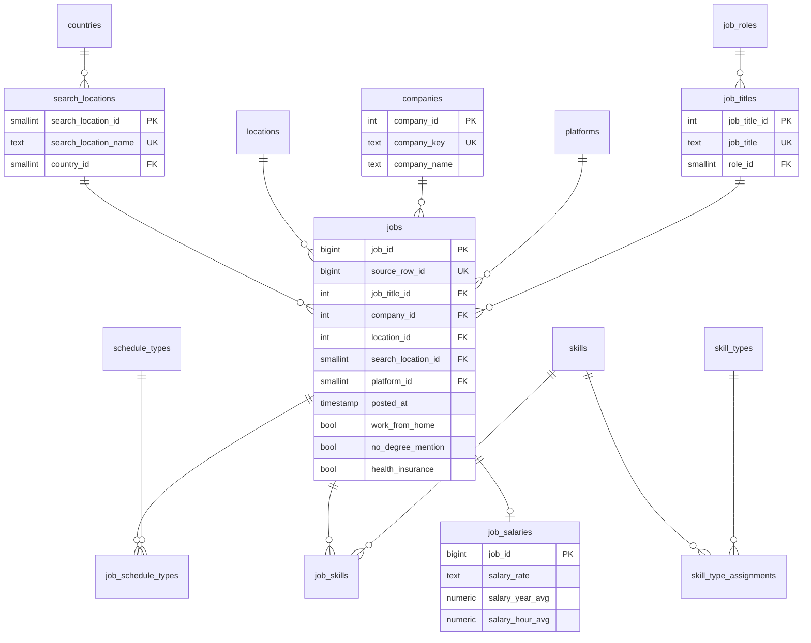

# Pipeline de ofertas de empleo: CSV → PostgreSQL en 3FN

Pipeline que toma `data_jobs.csv` (785.741 ofertas de empleo de 2023 scrapeadas de Google Jobs) y lo convierte en un modelo relacional normalizado en PostgreSQL, pensado para ser la fuente única de verdad de análisis posteriores.

- **Stack:** Python 3.12, pandas, Pandera, psycopg 3, PostgreSQL 17, Docker Compose, uv, pytest, ruff, GitHub Actions.
- **Entregables:** DDL del modelo en [`sql/schema.sql`](sql/schema.sql) y diagrama en [`docs/erd.dbml`](docs/erd.dbml) (también abajo en Mermaid).

## Contenido

1. [Cómo ejecutarlo](#cómo-ejecutarlo)
2. [Arquitectura](#arquitectura)
3. [Lo que encontré en los datos](#lo-que-encontré-en-los-datos)
4. [Modelo 3FN y decisiones de diseño](#modelo-3fn-y-decisiones-de-diseño)
5. [Por qué estas herramientas](#por-qué-estas-herramientas)
6. [Calidad de datos y tests](#calidad-de-datos-y-tests)
7. [Limitaciones y qué haría con más tiempo](#limitaciones-y-qué-haría-con-más-tiempo)
8. [Bonus: orquestación y CI/CD](#bonus-orquestación-y-cicd)
9. [Bonus: diseño de un modelo estrella (OLAP)](#bonus-diseño-de-un-modelo-estrella-olap)

---

## Cómo ejecutarlo

### Requisitos

- Docker Desktop (o Docker Engine + Compose v2).
- El archivo `data_jobs.csv` (no se versiona porque pesa ~220 MB). Hay que copiarlo a `data/data_jobs.csv`.
- Opcional, para correr fuera de Docker: [uv](https://docs.astral.sh/uv/) y Python ≥ 3.11.

### Opción A: todo en Docker

```bash
cp .env.example .env          # y cambiar la contraseña
docker compose up -d db       # levanta PostgreSQL y espera el healthcheck
docker compose --profile pipeline run --rm pipeline
```

El servicio `pipeline` está bajo un *profile* para que `docker compose up` no lo dispare solo: la base queda arriba y el pipeline se corre cuando uno quiere.

Para correr un solo paso:

```bash
docker compose --profile pipeline run --rm pipeline --step stage
```

### Opción B: Python local + Postgres en Docker

```bash
cp .env.example .env
docker compose up -d db
uv sync
uv run jobs-pipeline                 # o: uv run jobs-pipeline --step core
```

Sin uv también funciona con `pip install -r requirements.txt`.

### Consultar el resultado

```bash
docker compose exec db psql -U jobs -d jobs
```

```sql
-- Top 10 skills pedidos para Data Engineer
SELECT sk.skill_name, count(*) AS ofertas
FROM core.jobs j
JOIN core.job_titles t ON t.job_title_id = j.job_title_id
JOIN core.job_roles r  ON r.role_id = t.role_id
JOIN core.job_skills js ON js.job_id = j.job_id
JOIN core.skills sk     ON sk.skill_id = js.skill_id
WHERE r.role_name = 'Data Engineer'
GROUP BY sk.skill_name
ORDER BY ofertas DESC
LIMIT 10;
```

---

## Arquitectura

```
data_jobs.csv
     │  extract.py   lee, tipa, valida (Pandera) y carga con COPY
     ▼
raw.job_postings            copia fiel del CSV con tipos reales (TEXT[], JSONB, BOOLEAN, TIMESTAMP)
     │  stage.py     limpia, estandariza, deduplica, separa rechazos, valida
     ▼
staging.job_postings        una fila por oferta, limpia pero aún desnormalizada
staging.rejected_postings   lo que no pasó, con el motivo
     │  load_core.sql  carga set-based en una transacción + chequeos de calidad
     ▼
core.*                      modelo 3FN (15 tablas)
```

Separé el proceso en tres capas por razones concretas:

- **raw** guarda el dato tal como vino, solo tipado. Si mañana cambia una regla de limpieza, reproceso desde aquí sin volver a leer el archivo, y si alguien duda de un valor en `core`, `source_row_id` lo lleva directo a la fila original.
- **staging** es donde vive la limpieza en Python. Es `UNLOGGED` porque es transitoria y se recrea en cada corrida: no tiene sentido pagar el costo del WAL.
- **core** se carga con SQL puro. Python es bueno limpiando strings y probándose con pytest; Postgres es mejor resolviendo claves y cargando por conjuntos. Cada uno hace lo suyo.

Cada paso es **idempotente**: raw y core se recargan completos (`TRUNCATE` + carga) dentro de una transacción, así que correr el pipeline dos veces da el mismo resultado y un fallo a mitad no deja datos a medias. Elegí *full refresh* y no carga incremental porque la fuente es un archivo estático y, sobre todo, porque **no trae un identificador de oferta**: sin clave natural, un upsert incremental no tiene contra qué comparar (ver más abajo).

### Resultado de una corrida completa

En mi laptop (Windows 11, todo dentro de Docker) la corrida completa tarda unos 4 minutos:

| Paso | Tiempo |
|---|---|
| extract (CSV → raw) | 48 s |
| stage (raw → staging) | 92 s |
| core (staging → 3FN) | 63 s |
| chequeos de calidad | 27 s |

| Tabla | Filas | Tabla | Filas |
|---|---:|---|---:|
| `jobs` | 785.639 | `job_skills` | 3.594.700 |
| `job_titles` | 234.673 | `job_schedule_types` | 791.556 |
| `companies` | 130.368 | `job_salaries` | 33.066 |
| `locations` | 15.951 | `skill_type_assignments` | 256 |
| `platforms` | 7.884 | `skills` | 252 |
| `search_locations` | 173 | `skill_types` | 10 |
| `countries` | 168 | `job_roles` | 10 |
| `schedule_types` | 7 | rechazadas | 102 |

### Cómo bajó de 10 a 4 minutos

La primera corrida completa tardó casi 10 minutos, 7 de ellos en el paso core. Mi primera sospecha fue que a las tablas recién cargadas les faltaban estadísticas y el planner elegía mal los joins. Agregué `ANALYZE` después de cada carga masiva, que es buena práctica de todas formas, pero solo bajó a 5,5 minutos: no era la causa principal.

Medí cada sentencia por separado y dos concentraban el tiempo: el `INSERT` en `jobs` (2 min) y en `job_skills` (2 min 42 s). Con `EXPLAIN ANALYZE` quedó claro el motivo: de los 128 s del `INSERT` en `jobs`, 109 s eran los triggers internos que validan las 5 FK, uno por fila y por FK. El join en sí era rápido.

La solución es la misma que usa `pg_restore`: dentro de la transacción se quitan las FK, se cargan los datos y se recrean. Al recrearlas, Postgres valida todas las filas de una vez con un solo join en lugar de millones de búsquedas individuales. La integridad no se relaja: si una fila no cumple, la FK no se crea y toda la transacción se deshace. Las definiciones se leen del catálogo (`pg_get_constraintdef`), así que `sql/schema.sql` sigue siendo la única fuente del DDL. El paso core bajó de 410 s a 63 s.

---

## Lo que encontré en los datos

Antes de diseñar perfilé todo el archivo. Casi todas las decisiones del modelo salen de esta tabla:

| Hallazgo | Magnitud | Qué hice |
|---|---|---|
| Filas idénticas en las 17 columnas (misma fecha al segundo) | 101 | Rechazadas como duplicado, se conserva la primera |
| Filas iguales salvo `job_posted_date` | ~36.500 | **No** son duplicados: son republicaciones de la misma oferta. Se conservan |
| Fila sin título, empresa, ubicación ni skills | 1 | Rechazada (`sin job_title`) |
| `job_schedule_type` compuesto: "Full-time, Part-time, and Internship" | 48 combinaciones de 7 tipos | Se separa en tabla N:M. También traduzco "Pekerjaan tetap" y "Kontraktor" (etiquetas de Google Jobs en indonesio) |
| `job_via` con prefijo "via " y a veces "melalui " (indonesio) | 100% de filas | Se quita el prefijo |
| Misma empresa con distinta capitalización: "BNP Paribas", "Bnp Paribas", "BNP PARIBAS" | 8.922 grupos | Se unifican por clave normalizada: 139.985 nombres → 130.368 empresas |
| `job_location` con sufijo "(+3 others)" | 2.642 | Se quita el sufijo; se conserva la ubicación principal |
| Skills repetidos dentro de la misma oferta (`['sas', ..., 'sas']`) | 63.811 ofertas | Pasa con sas, mongodb, ruby y firebase, que el extractor clasifica en dos tipos a la vez. Se deduplica |
| `job_country` = "Sudan" en ofertas de Texas y Nuevo México | 21.781 | Ver la decisión sobre país más abajo. Se documenta, no se "corrige" |
| Búsqueda "Georgia" (el país) devolvió ofertas de Georgia (el estado de EE. UU.) | 32.424 | Mismo caso |
| `job_country` vacío | 49 | Todas vienen de búsquedas a nivel país ("Gabon"); se completa con ese país |
| `salary_rate` = month/week/day | 401 | No traen promedio (solo existen columnas anual y horaria). Se guarda la tarifa sin monto |
| `salary_hour_avg` con ruido flotante (61.159996) | — | Se redondea a centavos en core; raw guarda el valor original |
| Títulos truncados por el scraper ("...") | 15.790 | No hay forma de recuperarlos; se dejan |
| `job_work_from_home = True` ⇔ `job_location = 'Anywhere'` | 69.552 (coincidencia exacta) | Se mantiene como atributo de la oferta (ver decisiones) |

---

## Modelo 3FN y decisiones de diseño



Para llegar a 3FN me guié por una pregunta en cada columna: *¿de qué depende realmente este dato?* Y la respuesta la verifiqué contra los datos, no solo contra el diccionario.

### 1. El rol depende del título, no de la oferta

El diccionario dice que `job_title_short` se calcula a partir de `job_title`, y en los datos se cumple sin excepción: cada uno de los 234.674 títulos distintos tiene exactamente un rol. Si dejara `role_id` en `jobs` tendría una dependencia transitiva (`job → job_title → rol`), que es justo lo que 3FN prohíbe. Por eso existe `job_titles` con su `role_id`, y `jobs` solo apunta al título.

Aquí me equivoqué primero y vale la pena contarlo. Mi primera versión normalizaba espacios en los títulos, y el chequeo de dependencias funcionales del pipeline falló: 26 títulos quedaron con dos roles. Mirando los casos, "MIS Analyst" aparece 60 veces como *Data Scientist* y "MIS  Analyst" (doble espacio) como *Software Engineer*. El rol se calculó sobre el texto exacto, así que "limpiar" el título invalida la derivación. Decidí guardar el título tal cual viene.

### 2. El país depende de la búsqueda, no de la ubicación

Lo intuitivo era poner el país en `locations`. Los datos no lo permiten: `job_location → job_country` falla en 1.166 ubicaciones ("Abilene, TX" aparece como United States y como Sudan). En cambio `search_location → job_country` se cumple en el 100% de las filas. El país es un atributo de la búsqueda que hizo el bot, y por eso cuelga de `search_locations`.

Esto deja expuesto un problema del origen: la búsqueda "Sudan" trajo 21.781 ofertas que en su mayoría son de EE. UU. No lo corregí, porque para hacerlo bien habría que geocodificar `job_location` y eso es otro proyecto. Prefiero que el modelo refleje fielmente lo que dice la fuente y que el problema quede documentado y localizado (es una sola fila en `search_locations`), a meter una corrección a medias en la fuente de verdad.

### 3. `job_work_from_home` se queda en `jobs`

En este dataset `work_from_home` coincide exactamente con `location = 'Anywhere'`, así que podría argumentarse que es una dependencia `location → remoto`. No la modelé así porque una dependencia funcional es una regla del negocio, no una coincidencia de la muestra: una oferta en "Bogotá, Colombia" puede perfectamente ser remota. La coincidencia viene de cómo el scraper rotula las ofertas remotas, y si la fuente cambia ese comportamiento el modelo no debería romperse. Para el título sí acepté la dependencia porque la respaldan dos cosas: el diccionario la define y los datos la confirman.

### 4. Skills: N:M con ofertas y también N:M con tipos

`job_skills` resuelve la relación muchos a muchos entre ofertas y skills, con PK compuesta `(job_id, skill_id)`.

Lo menos obvio fue el tipo de skill. Pensaba ponerlo como `skill_type_id` en `skills`, pero sas, mongodb, ruby y firebase pertenecen a dos tipos (sas es `programming` y `analyst_tools`), y eso pasa en el 100% de sus apariciones. Es decir, la clasificación es propiedad del skill, no de la oferta. Por eso existe `skill_type_assignments` como N:M entre skills y tipos, y no hace falta guardar el tipo por oferta.

Consecuencia: `job_type_skills` no se almacena en `core`, porque se puede reconstruir con `job_skills` + `skill_type_assignments`. No me quedé con la suposición: uno de los chequeos de calidad reconstruye el diccionario de las 785 mil ofertas y lo compara contra staging. Cero diferencias.

### 5. Jornada: el texto compuesto rompe 1FN

"Full-time and Part-time" son dos valores en una celda, lo que viola la primera forma normal. Se separa en `schedule_types` (7 tipos) y la puente `job_schedule_types`. Una oferta sin jornada (1,6%) simplemente no tiene filas en la puente.

### 6. Salario en una tabla aparte

Solo el 4,2% de las ofertas publica salario. Guardarlo en `jobs` serían tres columnas casi siempre nulas, así que va en `job_salaries`, relación 1:0..1 con `jobs`. Los `CHECK` fijan la regla del origen: el promedio anual solo existe con tarifa anual y el horario con tarifa horaria. No convertí horario a anual (por ejemplo × 2080 horas): esa es una suposición analítica que corresponde a la capa de consumo, no a la fuente de verdad.

`salary_rate` lo dejé como `CHECK` sobre cinco valores y no como tabla catálogo. Son valores fijos y sin atributos propios; una tabla agregaría un join sin aportar nada.

### 7. Claves sustitutas y linaje

El origen no trae id de oferta y hay ~36 mil filas idénticas salvo la fecha, así que no hay clave natural confiable para `jobs`. Uso `job_id` como identidad y guardo `source_row_id` (con `UNIQUE`) para trazar cada oferta hasta su fila del CSV.

Los catálogos también usan claves sustitutas (`IDENTITY`), pero su clave natural lleva `UNIQUE`. Eso tiene un efecto que me gusta: los propios constraints validan las dependencias. Si un título llegara con dos roles, el `INSERT` en `job_titles` fallaría en lugar de cargar datos ambiguos.

### 8. Empresas: unificación conservadora

La identidad de una empresa es su nombre en minúsculas y con espacios colapsados (`company_key`); para mostrar se usa la variante más frecuente. A propósito **no** quité sufijos legales (Inc., S.A., LLC) ni hice fuzzy matching: un falso positivo fusiona dos empresas distintas en la fuente de verdad y es muy difícil de detectar después. Me pareció mejor dejar algunos duplicados que ensuciar datos correctos.

### Otros detalles

- Índices en todas las FK de `jobs` y en el lado "skill" de las puentes. Postgres no indexa las FK automáticamente.
- `posted_at` es `TIMESTAMP` sin zona horaria porque el origen no la trae; asumir UTC sería inventar.
- Tipos chicos (`SMALLINT`) en catálogos con pocos valores, `BIGINT` en `jobs` pensando en crecimiento.

---

## Por qué estas herramientas

- **PostgreSQL + Docker Compose:** es lo que pide la prueba y además encaja con el problema: tiene `TEXT[]` y `JSONB` nativos para la capa raw, y `unnest` / `jsonb_each` para desarmarlos en SQL. Compose deja el entorno reproducible con un comando.
- **psycopg 3 con `COPY`:** cargar 785 mil filas con `INSERT` fila a fila es lento; `COPY` es el mecanismo de carga masiva de Postgres. psycopg 3 adapta directamente listas de Python a `TEXT[]` y dicts a `JSONB` dentro del `COPY`.
- **pandas:** el volumen (785 mil filas) cabe holgado en memoria. Spark o Polars serían exagerar para esto.
- **`ast.literal_eval` para las listas y dicts:** vienen como repr de Python (comillas simples), así que `json.loads` no sirve. `literal_eval` solo evalúa literales, a diferencia de `eval`, que ejecutaría cualquier código del archivo. Además se parsea cada texto distinto una sola vez (177 mil de 668 mil), lo que bajó la lectura de ~95 s a ~23 s.
- **SQL plano y no dbt para staging → core:** con un solo destino y 15 tablas, un archivo SQL legible en una transacción es suficiente. dbt tendría sentido si el modelo creciera o si varios equipos lo mantuvieran, y la migración sería directa porque cada `INSERT ... SELECT` ya es prácticamente un modelo.
- **Pandera:** contratos de datos declarativos sobre DataFrames, que es justo lo que se valida antes de cada carga.
- **uv:** resuelve y bloquea dependencias (`uv.lock`) en segundos. `requirements.txt` se exporta desde el lock para quien prefiera pip.

---

## Calidad de datos y tests

La calidad se valida en tres momentos:

1. **Antes de cargar raw** (Pandera, `validation.raw_schema`): tipos, nulos, tarifas válidas, salarios positivos, que `job_skills` y `job_type_skills` describan los mismos skills, y que el promedio anual/horario sea coherente con la tarifa.
2. **Antes de cargar staging** (Pandera + chequeo de dependencias funcionales): `job_title → rol`, `search_location → país` y `company_key → nombre`. Si se rompen, el modelo dejaría de ser correcto, así que el pipeline se detiene con un mensaje que dice qué valores las rompen.
3. **Después de cargar core** (SQL, `load_core.QUALITY_CHECKS`):
   - conciliación: filas en raw = ofertas en core + rechazadas;
   - todos los skills y jornadas de staging están en las puentes;
   - `job_type_skills` se reconstruye exactamente desde el modelo;
   - todos los salarios llegaron.

### Correr los tests

```bash
uv run pytest                 # unitarios + integración
uv run pytest -m "not integration"   # solo unitarios, sin base de datos
uv run ruff check . && uv run ruff format --check .
```

- **Unitarios** (`test_extract`, `test_cleaning`, `test_validation`, `test_stage`): cubren parseo de los campos semiestructurados, cada regla de limpieza y los contratos. Usan [`tests/fixtures/sample_jobs.csv`](tests/fixtures/sample_jobs.csv), un CSV de 8 filas armado a mano donde cada fila representa un caso real del perfilado (duplicado exacto, republicación, fila sin título, "melalui", "(+3 others)", sas en dos tipos, país vacío, tarifa mensual, títulos que difieren solo en espacios).
- **Integración** (`test_integration`): corre el pipeline completo dos veces (para probar idempotencia) contra una base aparte `<POSTGRES_DB>_test` y verifica los conteos exactos de las 17 tablas. Si no hay Postgres disponible se saltan solos; en CI corren contra un Postgres real.

---

## Limitaciones y qué haría con más tiempo

- **Geocodificar `job_location`** para tener ciudad / región / país reales y corregir los casos "Sudan" y "Georgia". Es el problema de calidad más grande del dataset.
- **Resolución de entidades de empresas** más agresiva (sufijos legales, fuzzy matching), pero con revisión humana de los merges. También separar agregadores (Dice, Emprego) y placeholders ("Confidenziale") de los empleadores reales.
- **Ubicaciones múltiples:** el scraper solo guarda la primera ciudad de "(+3 others)". Si la fuente diera la lista completa, sería otra N:M.
- **Carga incremental:** requeriría un identificador estable de oferta en la fuente, o al menos un hash de contenido acordado como clave.
- **Migraciones** con Alembic o similar en lugar de `CREATE TABLE IF NOT EXISTS`, para poder evolucionar el esquema sin recrear.

---

## Bonus: orquestación y CI/CD

**CI (implementado):** [`.github/workflows/ci.yml`](.github/workflows/ci.yml) corre ruff (lint + formato) y pytest en cada push y pull request. Levanta Postgres como *service container*, así que los tests de integración también corren en CI.

**Orquestación (no implementada, cómo la haría):** el CLI ya está partido en pasos (`--step extract|stage|core`) que mapean uno a uno a tareas. En Airflow sería un DAG `extract >> stage >> core >> quality_checks`, cada tarea llamando a la misma función de Python, con reintentos en las tareas que tocan la base y un sensor sobre la llegada de un archivo nuevo. No lo implementé porque Airflow suma scheduler, webserver y su propia base de metadatos al compose para orquestar un archivo estático que se procesa en minutos; preferí invertir ese tiempo en el modelo y la calidad. Si hubiera que elegir algo liviano para este tamaño, Prefect o Dagster con un `@flow` envolviendo `run()` serían suficientes.

---

## Bonus: diseño de un modelo estrella (OLAP)

El modelo 3FN está optimizado para escribir sin redundancia. Un dashboard necesita lo contrario: pocas uniones y filtros simples. Así diseñaría la estrella a partir de `core`.

### Tabla de hechos

**`fact_job_posting`**, con granularidad de **una fila por oferta publicada** (la misma que `core.jobs`). Es la granularidad más fina disponible y desde ella se agrega a cualquier nivel.

| Medida | Tipo | Nota |
|---|---|---|
| `posting_count` | aditiva | siempre 1; facilita `SUM` en herramientas de BI |
| `salary_year_avg` | no aditiva | se promedia, nunca se suma |
| `salary_hour_avg` | no aditiva | ídem |
| `salary_year_equivalent` | no aditiva | anual o horaria × 2080, con la suposición explícita en el nombre de la columna |
| `skill_count` | aditiva | cantidad de skills pedidos |
| `has_salary` | flag | para calcular % de ofertas con salario publicado |

### Dimensiones

- **`dim_date`**: una fila por día (año, trimestre, mes, semana, día de la semana). Clave `date_key` tipo `20230616`.
- **`dim_company`**: empresa (SCD tipo 1: si cambia el nombre de display, se sobrescribe).
- **`dim_role`**: título → rol, como jerarquía para poder bajar de "Data Engineer" a los títulos concretos.
- **`dim_geography`**: búsqueda → país, desnormalizado.
- **`dim_location`**: ubicación textual de la oferta.
- **`dim_platform`**: plataforma de publicación.
- **`dim_schedule`**: una fila por *combinación* de jornadas (son solo 48) con flags `is_full_time`, `is_contractor`, etc. Evita una puente para un caso con tan pocas combinaciones.
- **`dim_job_flags`** (*junk dimension*): ver abajo.

### Los dos desafíos de diseño

**Skills (muchos a muchos).** Un hecho por oferta no puede tener "una" FK a skill. Hay dos caminos:

1. **Tabla puente** `bridge_job_skill (job_key, skill_key, weight)`, con `weight = 1 / skill_count`. Permite filtrar ofertas por skill desde `fact_job_posting`. El peso existe para el riesgo clásico de las puentes: si se suman salarios atravesando la puente, cada oferta cuenta una vez por cada skill y los totales se inflan. Con el peso, las asignaciones suman 1 por oferta.
2. **Una segunda tabla de hechos** `fact_job_skill` con granularidad oferta × skill (unos 3,6 millones de filas), con las mismas dimensiones más `dim_skill` (y sus tipos).

Para un dashboard de demanda de skills ("qué skills piden más para Data Engineer en Colombia") elegiría la segunda: es más fácil de usar correctamente en una herramienta de BI y no depende de que el analista recuerde aplicar pesos. La puente la dejaría para análisis que necesiten partir de la oferta y filtrar por skill.

**Flags booleanos (junk dimension).** `work_from_home`, `no_degree_mention` y `health_insurance` son tres booleanos de baja cardinalidad. Como columnas sueltas ensucian el hecho, y como tres dimensiones de dos filas cada una son excesivas. La solución es una **junk dimension** `dim_job_flags` con el producto cartesiano de todas las combinaciones (2³ = 8 filas) y una sola FK en el hecho. Se le pueden sumar otros atributos de baja cardinalidad como `salary_rate` o `has_salary` sin cambiar el diseño. En el dashboard quedan como filtros legibles ("Remoto: Sí / No") en lugar de `true/false`.

---

## Estructura del repositorio

```
├── docker-compose.yml        Postgres + servicio del pipeline
├── Dockerfile
├── pyproject.toml / uv.lock  dependencias (requirements.txt exportado del lock)
├── sql/
│   ├── raw.sql               capa raw
│   ├── staging.sql           capa staging + rechazos
│   ├── schema.sql            modelo 3FN (entregable)
│   └── load_core.sql         carga staging -> core
├── src/jobs_pipeline/
│   ├── pipeline.py           CLI y orquestación de pasos
│   ├── extract.py            fase 1: CSV -> raw
│   ├── cleaning.py           reglas de limpieza (funciones puras)
│   ├── stage.py              fase 2a: raw -> staging
│   ├── load_core.py          fase 2b: staging -> core + chequeos de calidad
│   ├── validation.py         contratos Pandera y dependencias funcionales
│   ├── config.py / db.py
├── tests/
├── docs/erd.dbml             diagrama para dbdiagram.io
└── .github/workflows/ci.yml
```
